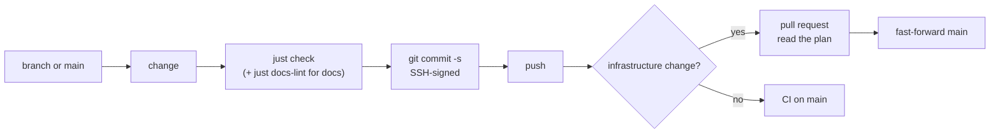

# Contributing

This is a one-maintainer repository; the rules below keep its history clean and its checks honest.
The why is in [ADR 0002 — solo flow](docs/adr/0002-solo-flow.md).

## Set up

Follow [Getting started](docs/tutorials/getting-started.md): one command builds the `iac` WSL distribution
with every tool, then `just setup` installs the git hooks.

## Make a change

1. Small batches: one topic per commit.
2. `just check` green before any push — it runs the same commands as CI.
3. Infrastructure changes (`terraform/`, `modules/`) go through a pull request so the plan is read before
   the apply on `main`.

## Commits

- [Conventional Commits](https://www.conventionalcommits.org/), subject in lower case:
  `feat(policy): add a Kyverno rule for …`.
- **Signed** (SSH, `commit.gpgsign=true`) and **signed off** (`git commit -s`, [DCO](https://developercertificate.org/)).
- **One human author**: no `Co-authored-by`, `Generated-by` or `Assisted-by` trailer and no
  "Generated with …" footer. The commit-msg hook and `commit-policy.yml` enforce it; `just commits` checks a branch.

## Merging

Fast-forward `main` to the reviewed branch (`git push origin <branch>:main`) so commits keep their own
signatures; a web "rebase and merge" re-creates them as GitHub commits.

## Docs

Pages follow [Diátaxis](https://diataxis.fr) under `docs/`; diagrams are Mermaid. `just docs-lint` must pass
(markdownlint, typos, links, every diagram renders).

## Skipping hooks

`SKIP=<hook-id> git commit …` skips one hook. CI runs the same checks, so a skipped hook only moves the
failure later.
