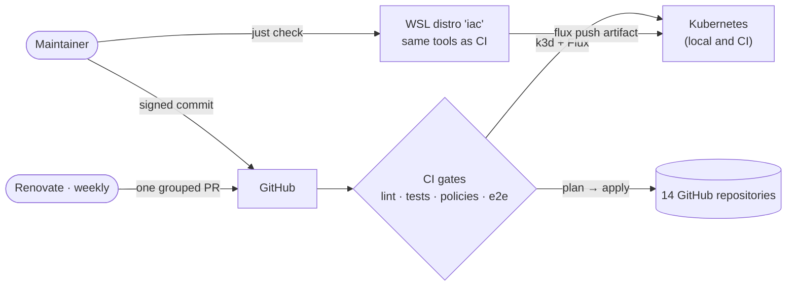

# iac

> A one-person platform, fully as code: GitHub governed by OpenTofu, a reproducible workstation built by Ansible,
> a Kubernetes cluster reconciled by Flux, and every change gated by policy-as-code — local first, zero budget.

[](https://github.com/GregoireF/iac/actions/workflows/k8s-e2e.yml)
[](https://github.com/GregoireF/iac/actions/workflows/policy.yml)
[](https://github.com/GregoireF/iac/actions/workflows/ansible.yml)
[](https://github.com/GregoireF/iac/actions/workflows/tofu-test.yml)
[](https://github.com/GregoireF/iac/actions/workflows/security-scan.yml)
[](https://securityscorecards.dev/viewer/?uri=github.com/GregoireF/iac)
[](LICENSE)

## In 30 seconds

- **GitHub as code** — 14 repositories (rulesets, labels, environments, secrets, files) managed by one OpenTofu module, tested with `tofu test` and guarded by OPA policies on the plan.
- **Reproducible workstation** — one PowerShell command builds a dedicated WSL distribution; Ansible installs ~20 tools, each from its official release and checksum-verified.
- **GitOps cluster** — k3d (k3s) with Flux, which reconciles this repository's `kubernetes/` tree pushed as an OCI artifact: uncommitted manifests are proven on a real cluster.
- **Same gates everywhere** — `just check` runs exactly what CI runs: format, lint, unit tests, OPA, kubeconform + Kyverno, ansible-lint, workflow security audit, IaC scanners, docs checks.
- **Autopilot** — Renovate opens one grouped PR a week and merges it when everything is green; Molecule installs every bumped tool before that merge.



## Stack

| Concern | Tooling |
|---|---|
| Infrastructure as code | [OpenTofu](https://opentofu.org) 1.13, `integrations/github` provider 6.13 |
| Workstation | WSL + Debian 13 (pinned digest), [Ansible](https://docs.ansible.com) 2.22, [uv](https://docs.astral.sh/uv/), [Molecule](https://ansible.readthedocs.io/projects/molecule/) |
| Kubernetes & GitOps | [k3d](https://k3d.io) / k3s 1.37, [Flux](https://fluxcd.io) 2.10 (OCI artifacts), Helm 4 |
| Policy as code | [OPA](https://www.openpolicyagent.org) (Rego v1), [Kyverno](https://kyverno.io) 1.20 (CEL), [kubeconform](https://github.com/yannh/kubeconform) |
| Supply chain & security | [zizmor](https://docs.zizmor.sh), actionlint, Trivy, Checkov, dependency-review, OpenSSF Scorecard, signed commits |
| Automation | GitHub Actions, [Renovate](https://docs.renovatebot.com), [just](https://just.systems) |
| Docs | Mermaid, markdownlint, typos, lychee — every diagram is rendered in CI |

## Quick start

```powershell
# Windows: build the 'iac' WSL distribution with every tool, a k3d cluster and Flux
pwsh scripts/wsl/new-distro.ps1 -WithCluster
```

```bash
# inside the distribution, at the repository root
just            # list every command, one line of explanation each
just check      # every CI gate, locally
just up         # (re)create the cluster and reconcile kubernetes/ through Flux
```

Full walkthrough: [Getting started](docs/tutorials/getting-started.md).

## Documentation

The docs follow [Diátaxis](https://diataxis.fr): learn, do, look up, understand.

| | |
|---|---|
| **Tutorial** | [Getting started](docs/tutorials/getting-started.md) — from a Windows PC to a green `just check` and a running cluster |
| **How-to guides** | [Add a repository](docs/how-to/add-a-repository.md) · [Release the module](docs/how-to/release-the-module.md) · [Change Kubernetes manifests](docs/how-to/change-kubernetes-manifests.md) · [Handle dependency updates](docs/how-to/update-dependencies.md) · [Add a provider stack](docs/how-to/add-a-provider-stack.md) · [Troubleshooting](docs/how-to/troubleshooting.md) |
| **Reference** | [Commands](docs/reference/commands.md) · [Workflows](docs/reference/workflows.md) · [Toolchain](docs/reference/toolchain.md) · [Policies](docs/reference/policies.md) · [Repository layout](docs/reference/layout.md) · [Module `github/repository`](modules/github/repository/README.md) |
| **Explanation** | [Architecture](docs/explanation/architecture.md) · [Delivery pipeline](docs/explanation/pipeline.md) · [GitOps loop](docs/explanation/gitops.md) · [Security model](docs/explanation/security-model.md) · [Roadmap & decisions](docs/ROADMAP.md) · [ADRs](docs/adr/) |

## Principles

1. **Same steps everywhere** — a check that only exists in CI is a bug.
2. **Pinned and verified** — binaries checked against vendor checksums, images and actions pinned by digest, Renovate keeps them current.
3. **One signed human author** — every commit SSH-signed and signed off; co-author and generated-by trailers are rejected.
4. **Small batches, fast feedback** — trunk-based flow and DORA metrics, after *The DevOps Handbook* ([ADR 0002](docs/adr/0002-solo-flow.md)).

## Contributing & security

See [CONTRIBUTING.md](CONTRIBUTING.md) and the [security policy](.github/SECURITY.md).

## License

[MIT](LICENSE) — Copyright © 2026 GregoireF
