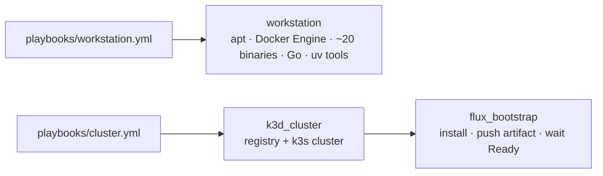

# ansible

Builds the workstation and the local cluster. The same playbooks run on the PC and in CI.



| Path | Content |
|---|---|
| `inventories/local.yml` | `localhost`, local connection |
| `playbooks/workstation.yml` | the `workstation` role |
| `playbooks/cluster.yml` | `k3d_cluster` then `flux_bootstrap` |
| `roles/workstation/` | every tool from its official release, checksum-verified, idempotent (version stamps); `molecule/` scenario |
| `roles/k3d_cluster/` | k3d registry (`localhost:5001`) and cluster (`--agents 1`, Traefik on 8080/8443) |
| `roles/flux_bootstrap/` | Flux install, `kubernetes/` pushed as an OCI artifact, `clusters/local` applied |

## Run

```bash
just workstation     # install or update tools
just up              # cluster + Flux
just ansible-lint    # production profile
just molecule        # workstation role in Debian (IAC_MOLECULE_BINARIES=all for every tool)
```

Inside `/mnt/<drive>` Ansible ignores `ansible.cfg` (world-writable directory); `just` sets
`ANSIBLE_CONFIG=ansible.cfg` for you.

Add a tool: append an entry to `workstation_binaries` in `roles/workstation/defaults/main.yml` with a
`# renovate:` comment, a `@V@` URL and a checksum URL — see the existing entries and
[Toolchain](../docs/reference/toolchain.md).
