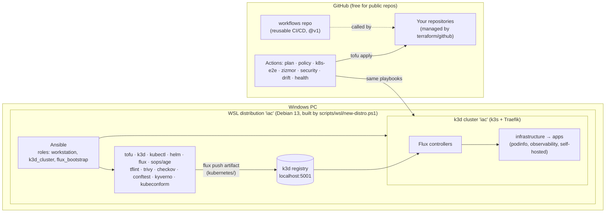

# Architecture

> One maintainer, zero budget, everything reproducible from this repository.
> Decisions: [ADR 0001 — repository layout](adr/0001-repository-layout.md) · [ADR 0002 — solo flow](adr/0002-solo-flow.md) · [Roadmap](ROADMAP.md)

## The big picture

## Layers

| Layer | Path | Tooling | Tested by |
|---|---|---|---|
| Workstation | `scripts/wsl/`, `ansible/roles/workstation` | WSL import of `debian:trixie` (pinned digest), Ansible, uv | idempotent re-run; Molecule (`just molecule`, `ansible.yml`) |
| GitHub as code | `terraform/github`, `modules/github/repository` | OpenTofu 1.13, `integrations/github` 6.13 | `tofu test` (20 tests), tflint, Conftest on the plan |
| Secrets | (migration) | SOPS + age (replaces Doppler) | — |
| Kubernetes | `kubernetes/` (Flux layout) | k3d/k3s, Flux 2.10 (OCI artifacts) | `k8s-e2e`: cluster + Flux Ready in CI |
| Policies | `policies/opentofu`, `policies/kubernetes` | OPA/Conftest (Rego v1), Kyverno 1.20 CEL `ValidatingPolicy`, kubeconform | `opa test`, negative samples |
| CI hygiene | `.github/workflows` | zizmor, actionlint, dependency-review, commit policy, Renovate | themselves |

## Principles

1. **Same steps everywhere.** CI runs the playbooks and commands you run locally (`just check`). A check that exists only in CI is a bug.
2. **Pinned and verified.** Every binary is downloaded from its official release and checked against the vendor checksum; images and actions are pinned by digest; Renovate keeps them current.
3. **Uncommitted changes are testable.** Flux reconciles `kubernetes/` from an OCI artifact pushed to the local registry, so a manifest change is proven on the cluster before any commit.
4. **Protections are layered.** Modules protect themselves (`prevent_destroy`, vulnerability alerts); policies re-check the plan independently.
