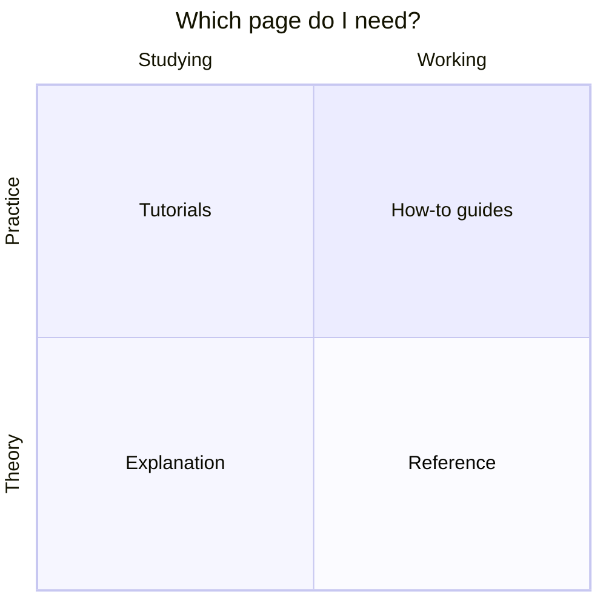

# Documentation

Organised with [Diátaxis](https://diataxis.fr): pick the page by what you need right now.

## Tutorials — learn by doing

- [Getting started](tutorials/getting-started.md): from a Windows PC to a green `just check` and a cluster reconciled by Flux.

## How-to guides — reach a goal

- [Use the self-service forms and commands](how-to/self-service.md)
- [Add a GitHub repository](how-to/add-a-repository.md)
- [Release the `github/repository` module](how-to/release-the-module.md)
- [Change Kubernetes manifests](how-to/change-kubernetes-manifests.md)
- [Handle dependency updates](how-to/update-dependencies.md)
- [Add a provider stack](how-to/add-a-provider-stack.md)
- [Troubleshooting](how-to/troubleshooting.md)

## Reference — look it up

- [Commands (`just`)](reference/commands.md)
- [Workflows](reference/workflows.md)
- [Toolchain and pins](reference/toolchain.md)
- [Policies](reference/policies.md)
- [Repository layout](reference/layout.md)
- [Module `github/repository`](../modules/github/repository/README.md) (generated by terraform-docs)

## Explanation — understand why

- [Architecture](explanation/architecture.md)
- [Delivery pipeline](explanation/pipeline.md)
- [GitOps loop](explanation/gitops.md)
- [Security model](explanation/security-model.md)
- [Roadmap and decisions](ROADMAP.md)
- Architecture decision records: [0001 — repository layout](adr/0001-repository-layout.md) · [0002 — solo flow](adr/0002-solo-flow.md)

## Writing docs here

- English, short sentences, commands that can be copied as they are.
- Diagrams in Mermaid: GitHub renders them, and `just docs-lint` (CI: `docs-quality.yml`) fails if one does not render.
- Every claim about an external tool links to its source.
