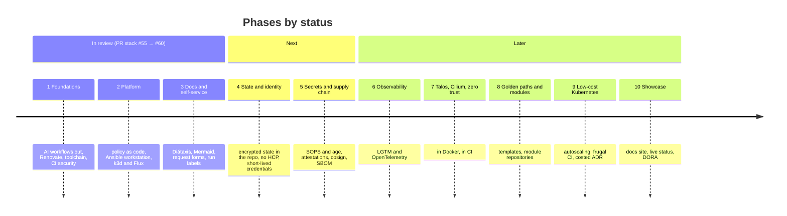

# Roadmap

> **Vision** — a modern infrastructure engineering laboratory: experiment, automate, document, industrialize.
> Infrastructure here is **versioned, automated, testable and reproducible**.
> Long-term goal: a curated collection of modern infrastructure engineering patterns.
> One maintainer, zero budget, maximum automation: everything that can run without a human runs without a human.

Updated 2026-11-22. This page replaces the former `IDEA.md`: every idea is either in a phase below or parked with its reason.

## Where we are

### Next three actions

1. Merge the PR stack #56 → #60 (plans of #56 and #60 reviewed before merging).
2. Phase 4: OpenTofu state encrypted in this repository, HCP Terraform and the `tfe` provider removed.
3. Phase 4: inventory every long-lived credential and replace what can be short-lived.

## Ideas → phases

Status: ✅ done (in review) · 🔨 in progress · 📅 planned · 🅿️ parked.

| Direction | Idea | Status | Where |
|---|---|---|---|
| 1. Terraform modules | VPC / networking | 📅 | Phase 7 — Kubernetes networking with Cilium (D12) |
| | Kubernetes | 📅 | Phase 7 — Talos cluster as code |
| | Cloudflare | 🅿️ | D19 — no budget, no public service yet |
| | GitHub Actions runners | 🅿️ | D18 — GitHub-hosted runners are free for public repositories |
| | Observability | 📅 | Phase 6 — observability kit |
| | Secrets management | 📅 | Phase 5 — SOPS + age |
| 2. Kubernetes & Talos | Talos Linux | 📅 | Phase 7 (D11) |
| | GitOps / Flux | ✅ | Phase 2 — Flux reconciles an OCI artifact (D5) |
| | ArgoCD | 🅿️ | D5 — Flux kept; one GitOps engine is enough |
| | Secure cluster bootstrapping | 📅 | Phase 7 — Talos machine config as code |
| 3. Platform engineering | Golden paths | 🔨 | Phase 3 (request forms) → Phase 8 (templates) |
| | Infrastructure templates | 📅 | Phase 8 |
| | Developer platform | 🔨 | Phase 3 — self-service forms, `run:*` labels, `just` menu |
| | Deployment workflows | ✅ | Phases 1–3 — plan on PR, apply on merge, Flux |
| 4. Observability | Prometheus, Loki, Grafana, OpenTelemetry | 📅 | Phase 6 (D13) |
| 5. Self-hosting | Homelab, edge, private / hybrid cloud | 🅿️ | D23 — no hardware or budget; the k3d cluster stands in |
| 6. CI/CD & automation | GitHub Actions, policy enforcement | ✅ | Phases 1–2 |
| | Reusable workflows | 📅 | Phase 8 — `workflows` repository (ADR 0001) |
| | Release automation | 🔨 | `release.yml` today; module repositories in phase 8 |
| 7. Security & compliance | SOPS | 📅 | Phase 5 (D8) |
| | Supply-chain security | 🔨 | Phase 1 (pinning, zizmor, dependency review) → Phase 5 (D16) |
| | IAM, workload identity | 📅 | Phase 4 (D20) |
| | Zero-trust networking | 📅 | Phase 7 (D21) |
| | Vault | 🅿️ | D8 — SOPS + age, no service to run |
| 8. Cost optimization | Autoscaling, low-cost Kubernetes | 📅 | Phase 9 (D18, D22) |
| | Hetzner, spot instances | 🅿️ | D11 — local only until there is a budget |
| 9. Future ecosystem | terraform-modules | 📅 | Phase 8 — one repository per published module (D17) |
| | observability-kit, talos-cluster | 📅 | Phases 6–7 — folders here, publishable as OCI artifacts (D17) |
| | homelab, cloudflare-tooling | 🅿️ | D23, D19 |

## Phases

Each phase ends when its **done when** holds; the next one starts only then (small batches, [ADR 0002](adr/0002-solo-flow.md)).

### 1. Foundations — ✅ in review (#55 merged, #56, #57)

- AI workflows removed (D1); Renovate replaces Dependabot (D3)
- OpenTofu 1.13.9, Go 1.27, current providers; vulnerable Go modules upgraded
- zizmor + actionlint clean, dependency review, single signed author per commit, docs checked not committed (D9)

**Done when** every workflow is green on `main` and Renovate's first grouped PR merges by itself.

### 2. Platform — ✅ in review (#58)

- OPA rules for plans, Kyverno baseline for manifests
- WSL distribution and workstation role (checksum-verified tools, Molecule) (D6)
- k3d cluster reconciled by Flux from an OCI artifact, `k8s-e2e` in CI (D4, D5)

**Done when** `just check` and `k8s-e2e` are green on `main`.

### 3. Docs and self-service — ✅ in review (#59, #60)

- Diátaxis documentation, Mermaid diagrams, docs quality gates
- request forms → `just request` → signed pull request; `run:plan`, `run:e2e`, `run:check` labels; `just` menu (D14)

**Done when** a real request goes from issue to merged pull request.

### 4. State and identity — 📅 next

- OpenTofu state encryption (`pbkdf2` + `aes_gcm`) stored on a `tfstate` branch; locking by Actions `concurrency` (D2)
- HCP Terraform and the `tfe` provider removed; modules consumed by relative path (D10)
- OPA rules enforced on the real saved plan (Conftest), not only unit-tested
- Credentials inventory: every long-lived token replaced by a short-lived one where the target allows it; GitHub App permissions reviewed (D20)

**Done when** a plan and an apply run without HCP, and no workflow holds a long-lived token it does not need.

### 5. Secrets and supply chain — 📅

- SOPS + age for OpenTofu and Flux; Doppler stack retired (D8)
- GitHub artifact attestations, cosign-signed OCI artifacts verified by Flux, SBOM + scan, OpenSSF Scorecard ≥ 9 (D16)

**Done when** Flux refuses an unsigned artifact in `k8s-e2e`.

### 6. Observability — 📅

- LGTM + OpenTelemetry Collector with a lite profile for the PC (D13); then Gatus (status), Garage (S3), cert-manager

**Done when** podinfo's metrics, logs and traces show in Grafana, provisioned as code.

### 7. Talos, Cilium and zero trust — 📅

- Talos machine configuration as code; a Talos-in-Docker cluster in CI with the same Flux tree (D11)
- Cilium as CNI with Hubble and Gateway API (D12)
- Default-deny NetworkPolicies per namespace, then encrypted service-to-service traffic (D21)

**Done when** `k8s-e2e` passes on Talos + Cilium with default deny.

### 8. Golden paths and modules — 📅

- Templates for an app, a repository, an OpenTofu module, an ephemeral preview environment (D15)
- Published modules in `terraform-<provider>-<name>` repositories; reusable workflows in a `workflows` repository (D17, ADR 0001)

**Done when** a new module repository is created, tested and released from a form.

### 9. Low-cost Kubernetes — 📅

- Requests and limits everywhere, lite cluster profile, `just down` when idle (D18)
- Autoscaling: HorizontalPodAutoscaler, then event-driven autoscaling with KEDA (D22)
- Weekly CI-minutes report; a costed ADR (homelab vs cloud) for the day 24/7 is needed

**Done when** an app scales up and down on load in `k8s-e2e`.

### 10. Showcase — 📅

- Starlight site on GitHub Pages with live status (CI, versions, DORA metrics) and a weekly health issue (ADR 0002)
- `AGENTS.md`, `examples/`

**Done when** a visitor understands the platform in 30 seconds and can browse every decision.

## Decisions

| # | Decision | Why |
|---|---|---|
| D1 | **Remove the three AI workflows** (issue triage, PR review, changelog) | They call `models.inference.ai.azure.com`; GitHub Models was retired on 2026-07-30 ([summary](https://daily.dev/posts/github-models-is-being-fully-retired-on-july-30-2026-bz8saavyw), [migration guide](https://www.cloudkaramchari.com/blog/github-models-retirement-migration-guide/)). `ai-pr-review` failed 4/4 runs since 2026-11-14. Replaced by deterministic checks. |
| D2 | **100 % OpenTofu: leave HCP Terraform** | Encrypted state ([OpenTofu state encryption](https://opentofu.org/docs/language/state/encryption), `pbkdf2` + `aes_gcm`) stored **in this repository** on a `tfstate` branch. Locking = GitHub Actions `concurrency` (single maintainer). No external account. |
| D3 | **Renovate replaces Dependabot** | One grouped weekly PR for every non-major update, auto-merged when green; majors and pinned-hash tools wait for a human. Regex managers cover every `# renovate:` annotation, `==` PyPI pin and `image:tag@digest`. |
| D4 | **k3d** (k3s in Docker), locally and in CI | Traefik and local-path storage built in ([k3d](https://k3d.io)); its registry lets Flux reconcile uncommitted changes as an OCI artifact ([Flux OCI cheatsheet](https://fluxcd.io/flux/cheatsheets/oci-artifacts/)). Replaces kind. |
| D5 | **Flux** for GitOps, not ArgoCD | Everything declared in Git, OCI artifacts, image and chart updates through Renovate ([repository structure](https://fluxcd.io/flux/guides/repository-structure/)). One engine is enough. |
| D6 | **Ansible** for the workstation and the cluster bootstrap; Molecule for `workstation`, `k8s-e2e` for the cluster roles | Reproducible workstation; every role proven in CI ([Molecule](https://ansible.readthedocs.io/projects/molecule/)). |
| D7 | Import CI hygiene from `ship-it` / `kiwa` | zizmor + actionlint, dependency-review, commit policy, labels as code. |
| D8 | **SOPS + age replace Doppler**; no Vault or OpenBao | Secrets encrypted in Git, read by OpenTofu ([carlpett/sops provider](https://registry.terraform.io/providers/carlpett/sops/latest/docs)) and Flux ([Flux SOPS guide](https://fluxcd.io/flux/guides/mozilla-sops/)). No service to run, no external account. |
| D9 | **No CI bot commits** | terraform-docs runs in a pre-commit hook; CI only checks. Every commit on `main` has one signed human author ([ADR 0002](adr/0002-solo-flow.md)). |
| D10 | **Stacks consume modules by relative path** once HCP Terraform is gone | The `?ref=` git source exists only because HCP uploads `terraform/github/` alone. |
| D11 | **Local only for now; Talos Linux for the future real cluster**, rehearsed in Docker in CI | No budget. Hetzner raised prices twice in 2026 (CAX11 €4.49 → €5.99/month excl. VAT) and cost-optimized plans were intermittently unavailable ([Northflank](https://northflank.com/blog/hetzner-cloud-server-price-increases), [Bitdoze](https://www.bitdoze.com/hetzner-cloud-cost-optimized-plans/)). Talos is immutable and API-driven, the secure-bootstrap target; latest release v1.14.6 (2026-11-11). |
| D12 | **Networking = Kubernetes networking**: Cilium (CNI, NetworkPolicies, Hubble, Gateway API) | Real and testable locally and in CI at no cost; a cloud VPC module would never be applied. |
| D13 | **Observability = LGTM + OpenTelemetry** | The standard stack visitors and recruiters recognise. Replaces the Victoria-stack proposal. |
| D14 | **Self-service in this repository**: request forms, `run:*` labels on pull requests, `just` menu | Owner-only. Labels rather than `/commands`: only a privileged user can add a label, and zizmor flags `issue_comment` as a dangerous trigger ([zizmor](https://docs.zizmor.sh/audits/#dangerous-triggers)). Commits made locally by `just request`, so the single-author rule holds. |
| D15 | **Golden paths**: app, repository, OpenTofu module, ephemeral preview environment | Each is a form or command that ends in a reviewed PR. |
| D16 | **Supply chain**: artifact attestations, cosign-signed OCI artifacts verified by Flux, SBOM + scan, Scorecard ≥ 9 | Every artifact Flux deploys is signed and traceable to its workflow run. |
| D17 | **Repository split: published modules only** — `terraform-<provider>-<name>` | Registries require that name; an outside consumer is an ADR 0001 criterion. observability-kit and talos-cluster stay folders here. |
| D18 | **Cost**: requests/limits, lite profile, CI-minutes report, costed ADR; no self-hosted runner | Public repositories run on free GitHub-hosted runners; the self-hosted runner fee announced for March 2026 was postponed ([GitHub changelog](https://github.blog/changelog/2025-12-16-coming-soon-simpler-pricing-and-a-better-experience-for-github-actions/)). A self-hosted runner would only exist while the PC is on. |
| D19 | **Parked: Cloudflare** (DNS, Tunnel, Access, Pages/R2) | No budget and no public service yet. |
| D20 | **Workload identity**: short-lived credentials wherever the target allows it | Today CI holds long-lived tokens (HCP, Doppler). Phase 4 inventories them and replaces each one that has a short-lived alternative; the rest is documented with its scope. |
| D21 | **Zero trust inside the cluster**: default-deny NetworkPolicies, then encrypted service-to-service traffic | Free, local, testable in `k8s-e2e`; no perimeter product needed while nothing is public. |
| D22 | **Autoscaling**: HPA first, KEDA for event-driven workloads | Built-in and CNCF tooling, demonstrable on the local cluster without a cloud. |
| D23 | **Parked: homelab, edge, private and hybrid cloud** | No hardware or budget today; the k3d cluster and the Talos rehearsal in CI prepare it. |

Honest limit: a cluster on the PC only runs **while the PC is on**. Anything that must run 24/7 (Renovate, plans, scans) stays in GitHub Actions, free for public repositories.

## See also

- Current tool versions and where they are pinned: [Toolchain](reference/toolchain.md)
- Repository layout: [Layout](reference/layout.md) · every gate: [Commands](reference/commands.md) · [Workflows](reference/workflows.md)
- Architecture decision records: [ADRs](adr/README.md)
