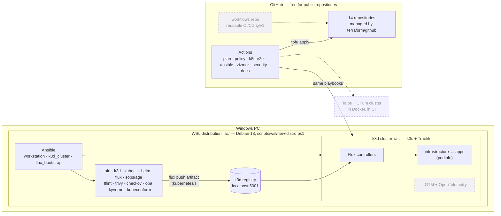

# Architecture

> One maintainer, zero budget, everything reproducible from this repository.
> Decisions: [Roadmap](../ROADMAP.md) · [ADR 0001 — repository layout](../adr/0001-repository-layout.md) · [ADR 0002 — solo flow](../adr/0002-solo-flow.md)

## The big picture

Solid lines exist today; dashed boxes are planned in the [roadmap](../ROADMAP.md).

## Layers

| Layer | Path | Tooling | Tested by |
|---|---|---|---|
| Workstation | `scripts/wsl/`, `ansible/roles/workstation` | WSL import of `debian:trixie` (pinned digest), Ansible, uv | idempotent re-run; Molecule (`just molecule`, `ansible.yml`) |
| GitHub as code | `terraform/github`, `modules/github/repository` | OpenTofu 1.13, `integrations/github` 6.13 | `tofu test` (20 tests), tflint, OPA rules (unit-tested) |
| Secrets | `terraform/doppler` today | Doppler → SOPS + age (decision D8) | — |
| Kubernetes | `kubernetes/` (Flux layout) | k3d/k3s, Flux 2.10 (OCI artifacts) | `k8s-e2e`: cluster + Flux Ready in CI |
| Policies | `policies/opentofu`, `policies/kubernetes` | OPA (Rego v1), Kyverno 1.20 CEL `ValidatingPolicy`, kubeconform | `opa test`, rendered overlays |
| CI hygiene | `.github/workflows` | zizmor, actionlint, dependency-review, commit policy, Renovate | themselves |
| Docs | `docs/`, every `README.md` | Mermaid, markdownlint, typos, lychee | `docs-quality.yml` |

## Principles

1. **Same steps everywhere.** CI runs the playbooks and commands you run locally (`just check`). A check that exists only in CI is a bug.
2. **Pinned and verified.** Every binary is downloaded from its official release and checked against the vendor checksum; images and actions are pinned by digest; Renovate keeps them current.
3. **Uncommitted changes are testable.** Flux reconciles `kubernetes/` from an OCI artifact pushed to the local registry, so a manifest change is proven on the cluster before any commit ([GitOps loop](gitops.md)).
4. **Protections are layered.** Modules protect themselves (vulnerability alerts, rulesets); policies re-check plans and manifests independently ([Policies](../reference/policies.md)).
5. **Local first, pay later.** Nothing runs on paid infrastructure; the target real cluster (Talos) is rehearsed in CI before any hardware exists.
