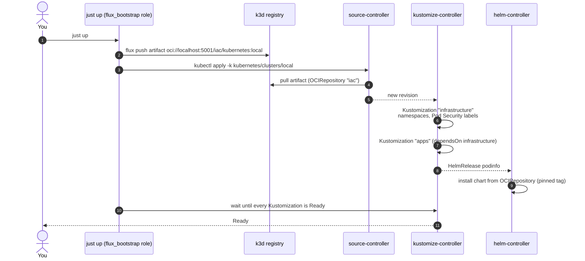

# GitOps loop

Flux keeps the cluster equal to what this repository declares. The twist: locally, Flux does not pull
from Git but from an **OCI artifact** pushed to the k3d registry, so even uncommitted changes go through
the real reconciliation path ([Flux OCI artifacts](https://fluxcd.io/flux/cheatsheets/oci-artifacts/)).

## Why an OCI artifact rather than a Git source

| | Git source | OCI artifact (here) |
|---|---|---|
| Tests uncommitted changes | no — Flux sees only pushed commits | yes — `just up` pushes the working tree |
| Needs network to GitHub | yes | no — the registry runs next to the cluster |
| Same path in CI | needs a deploy key | yes — `k8s-e2e.yml` runs the same playbook |
| Supply chain | commit signatures | artifacts can be signed with cosign and verified by Flux (planned, D16) |

## Ordering and safety

- `apps` depends on `infrastructure`: namespaces and their Pod Security level exist before any workload.
- Every HelmRelease declares install and upgrade remediation (enforced by Kyverno), so a failed upgrade rolls back.
- Chart sources pin a tag or digest (enforced by Kyverno); Renovate moves the pin.
