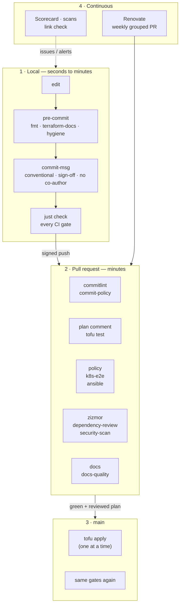

# Delivery pipeline

How a change travels from the keyboard to GitHub, the cluster and the managed repositories — and which
gate can stop it at each step. Built on the "Three Ways" of *The DevOps Handbook*: flow (small batches),
fast feedback (gates as early as possible), continual learning (weekly health and DORA metrics, planned).

## Why each gate sits where it does

| Gate | Earliest place | Why there |
|---|---|---|
| Formatting, docs generation | pre-commit | Fixes itself; never worth a CI round-trip |
| Commit message policy | commit-msg hook, then CI | One human author, DCO sign-off; CI re-checks because hooks can be skipped |
| Unit tests, policies, schemas | `just check`, then PR | Fast and offline: they run on every change |
| Cluster end to end | `just up` (optional), then PR | Minutes, but the only proof that Flux reconciles |
| Workflow audit, dependency review | PR | Need GitHub context (online audits, dependency graph) |
| Apply | `main` only | The plan was read in the PR; applies never run in parallel |

## Flow for a solo maintainer

[ADR 0002](../adr/0002-solo-flow.md) keeps the batch small: green locally, then push. Large or
infrastructure-changing work goes through a PR, so the plan is read before anything is applied.
Renovate is the only other author: one PR a week, merged by itself when every gate is green.
