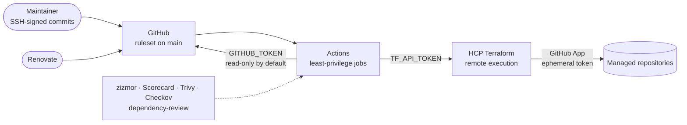

# Security model

Who can change what, with which credentials, and what stops a bad change.

## Controls

| Area | Control | Where |
|---|---|---|
| Identity | One human author, commits SSH-signed and signed off; co-author and generated-by trailers rejected | commit-msg hook, `commit-policy.yml`, [ADR 0002](../adr/0002-solo-flow.md) |
| Branch | `main` ruleset: no deletion, no force-push, pull request and status checks (admin bypass for the owner) | `terraform/github` |
| GitHub API | GitHub App with scoped permissions and ephemeral tokens, no personal access token | `terraform/github/providers.tf` |
| State and secrets | Secrets in HCP Terraform workspace variables today; OpenTofu state encryption and SOPS + age planned (D2, D8) | [Roadmap](../ROADMAP.md) |
| Workflows | Actions pinned by SHA, read-only permissions by default, no persisted checkout credentials, no template injection, explicit secrets | zizmor + actionlint |
| Dependencies | Vulnerable additions blocked at moderate severity; weekly updates; Go test modules free of MEDIUM+ advisories | `dependency-review.yml`, Renovate |
| Downloads | Every tool verified against its vendor checksum or a pinned hash; images pinned by digest | `ansible/roles/workstation` |
| Infrastructure code | Trivy and Checkov on every PR; OPA rules for destructive plans | `security-scan.yml`, [Policies](../reference/policies.md) |
| Cluster | Pod Security labels on every namespace (`restricted` for apps); pinned chart sources; HelmRelease remediation | Kyverno baseline |
| Posture | OpenSSF Scorecard weekly | `scorecard.yml` |

## Planned (roadmap D16)

GitHub artifact attestations, cosign-signed OCI artifacts verified by Flux, SBOMs with vulnerability
scans, and an OpenSSF Scorecard of 9 or more.

Report a vulnerability through the [security policy](../../.github/SECURITY.md).
