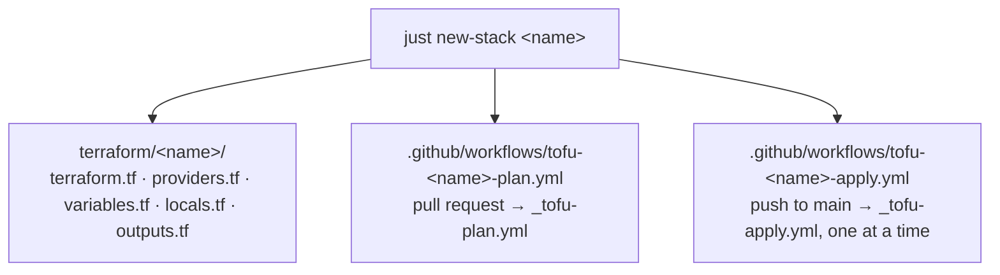

# Add a provider stack

A stack is one OpenTofu root module under `terraform/<name>/` with its own state and its own
plan/apply workflows. The generator writes a skeleton that already passes `tofu fmt`, actionlint and zizmor.

```bash
just new-stack cloudflare
```



## Then

1. `terraform/<name>/terraform.tf`: add `required_providers` (the OpenTofu constraint and the HCP
   organisation are filled in from `.opentofu-version` and `terraform/github`).
2. `terraform/<name>/providers.tf`: configure the provider; credentials come from workspace variables, never from files.
3. Create the HCP Terraform workspace `<name>` and its variables.
4. Lock providers for every platform the repository supports:

   ```bash
   cd terraform/<name>
   tofu init -backend=false
   tofu providers lock -platform=linux_amd64 -platform=linux_arm64 -platform=darwin_arm64 -platform=windows_amd64
   ```

5. `just check`, then a pull request: the plan is posted as a comment.

Backends change in phase 2 of the [roadmap](../ROADMAP.md): state encrypted by OpenTofu and stored in this
repository, instead of HCP Terraform. The generator will follow.
