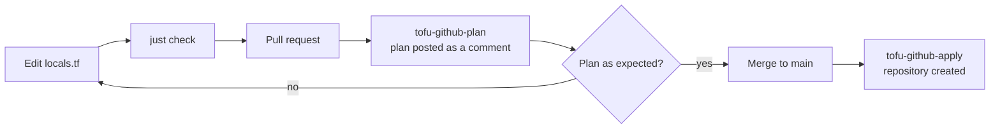

# Add a GitHub repository

Every repository of the account is declared in `terraform/github/locals.tf` and built by the
[`github/repository` module](../../modules/github/repository/README.md): settings, default-branch ruleset,
environments, deploy keys, vulnerability alerts and standard files. Labels, keys and Actions variables are
added by the stack itself (`labels.tf`, `keys.tf`, `actions-config.tf`).



## Steps

1. Add an entry to `local.repositories` in `terraform/github/locals.tf`:

   ```hcl
   my-new-repo = {
     description            = "What it does, in one sentence."
     topics                 = ["example"]
     visibility             = "public"
     has_issues             = true
     has_wiki               = false
     has_projects           = false
     allow_merge_commit     = false
     allow_squash_merge     = true
     allow_rebase_merge     = false
     delete_branch_on_merge = true
     archived               = false
     allow_auto_merge       = true
     inject_standard_files  = true

     branch_protection = {
       enabled                      = true
       required_status_checks       = []
       enforce_conventional_commits = true
     }
   }
   ```

   Every attribute is described in the [module reference](../../modules/github/repository/README.md).

2. Check locally: `just check`.
3. Open a pull request. The `tofu-github-plan` workflow posts the plan as a comment. Read it for
   deletions: the OPA rules that refuse a repository deletion or a public repository without
   vulnerability alerts are unit-tested today, and will gate the real plan once state leaves
   HCP Terraform (phase 2, [Policies](../reference/policies.md)).
4. Merge when the plan shows only the expected creations. `tofu-github-apply` applies it.

## Import an existing repository

Add the same entry, plus an `import` block in `terraform/github/imports.tf`, so the plan adopts the
repository instead of creating it. Remove the block after the first apply.
