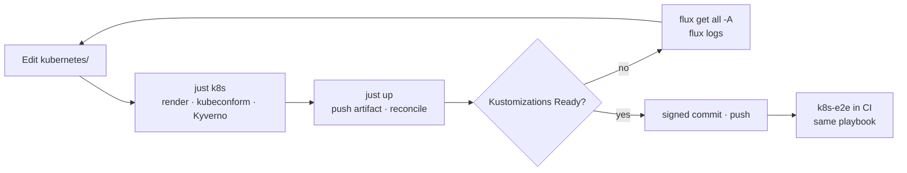

# Change Kubernetes manifests

Flux reconciles `kubernetes/` from an OCI artifact that `just up` pushes to the k3d registry, so you can
prove a change on a real cluster **before committing it** ([why](../explanation/gitops.md)).



## Layout

| Path | Role |
|---|---|
| `kubernetes/clusters/local/` | Entry point applied once: the `OCIRepository` source and two Flux `Kustomization`s |
| `kubernetes/infrastructure/` | Cluster-wide pieces: namespaces with Pod Security labels, later controllers and observability |
| `kubernetes/apps/` | Workloads, reconciled after infrastructure (`dependsOn`) |

Each of `infrastructure/` and `apps/` has a `base/` and an overlay per cluster (`local/`). Only overlays are deployed.

## Add an application

1. Create `kubernetes/apps/base/<app>/` with a source (`OCIRepository` for an OCI chart) and a
   `HelmRelease`; copy `podinfo/` as a model. The baseline policies require a remediation strategy on
   the HelmRelease and a pinned tag or digest on the source.
2. Add `../base/<app>` to the `resources` of each overlay that should run it (`kubernetes/apps/local/kustomization.yaml`).
3. `just k8s` — schemas and policies; `just up` — real reconciliation.
4. Commit; `k8s-e2e` repeats the whole bootstrap in CI.

## Useful commands

```bash
flux get kustomizations
flux get helmreleases -A
flux reconcile source oci iac
kubectl -n flux-system logs deploy/kustomize-controller --tail=50
```
