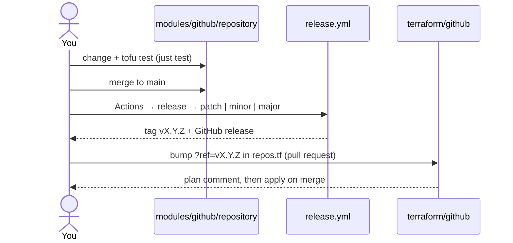

# Release the `github/repository` module

`terraform/github/repos.tf` consumes the module through an immutable git tag
(`?ref=v1.3.1`), because HCP Terraform only uploads `terraform/github/`. A module change therefore
reaches the stack in two steps. This disappears in phase 4 of the [roadmap](../ROADMAP.md) (decision D10:
relative module path once HCP Terraform is gone).

## Steps

1. Change the module, add or update a test in `modules/github/repository/tests/`, run `just test`.
2. Module docs are regenerated by the pre-commit hook (or `just docs`); CI only checks them.
3. Merge to `main`, then run **Actions → release → Run workflow** with the bump type.
4. Open a pull request that moves `?ref=` in `terraform/github/repos.tf` to the new tag; read the plan.
