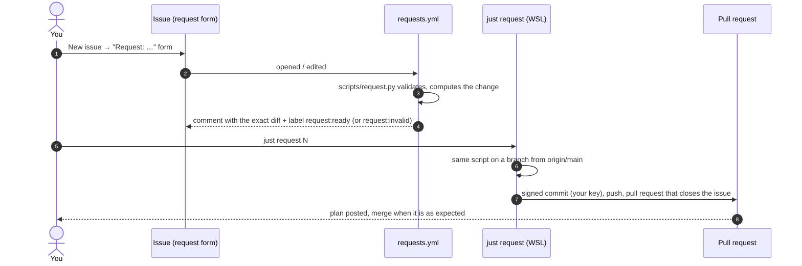

# Use the self-service forms and commands

Two entry points let the platform be driven without remembering any command:
**request forms** (issues) for changes, and **command labels** on pull requests for runs.
Only the owner's issues and labels are acted upon; visitors can read everything.

## Requests: from a form to a signed pull request

| Form | Changes | Result |
|---|---|---|
| **New repository** | `terraform/github/locals.tf`: a new entry with the standard settings | the repository is created on apply |
| **New app on the cluster** | `kubernetes/apps/base/<name>/` (OCIRepository + HelmRelease) and the local overlay | Flux deploys it; set the chart values for the restricted Pod Security Standard first |
| **Archive a repository** | `archived = true` on its entry | archived on apply — never deleted (OPA policy) |
| **Module release** | runs `release.yml`, then moves `?ref=` in `terraform/github/repos.tf` to the new tag | a pull request with the plan |

Why the last step is local: the commit is made by you, signed with your key, so the repository keeps a
single human author ([ADR 0002](../adr/0002-solo-flow.md)). A workflow could open the pull request itself,
but its commits would be authored by a bot.

### One-time setup

1. `just workstation` (or the first `new-distro.ps1` run) creates a signing key for the WSL distribution and
   prints its public key: add it on GitHub under **Settings → SSH and GPG keys → New SSH key**, type **Signing key**.
2. In the distribution: `gh auth login` (HTTPS, browser).

### Validation rules

The form is checked twice, by the workflow and again by `just request`, with the same `scripts/request.py`:
repository names and topics follow GitHub's rules, an app name is a DNS label, the chart is an `oci://` URL
with a semantic version, a repository must exist to be archived and must not exist to be created. Values
are escaped before they reach HCL.

## Command labels on pull requests

Add a label to a pull request; the label removes itself once the runs are dispatched on the PR branch.

| Label | Runs |
|---|---|
| `run:plan` | OpenTofu plans of both stacks, posted on the pull request |
| `run:e2e` | `k8s-e2e.yml`: k3d + Flux end to end |
| `run:check` | `tofu-test`, `policy`, `ansible`, `zizmor`, `docs-quality`, `security-scan` |

Labels rather than `/commands` in comments: only a privileged user can add a label, and `pull_request`
is a safe trigger, whereas zizmor flags `issue_comment` as a dangerous one
([zizmor: dangerous-triggers](https://docs.zizmor.sh/audits/#dangerous-triggers)).

## The command menu

`just` with no argument opens a searchable menu (fzf) with a preview of each recipe; pick one, press Enter.
Outside a terminal it prints the list instead.
