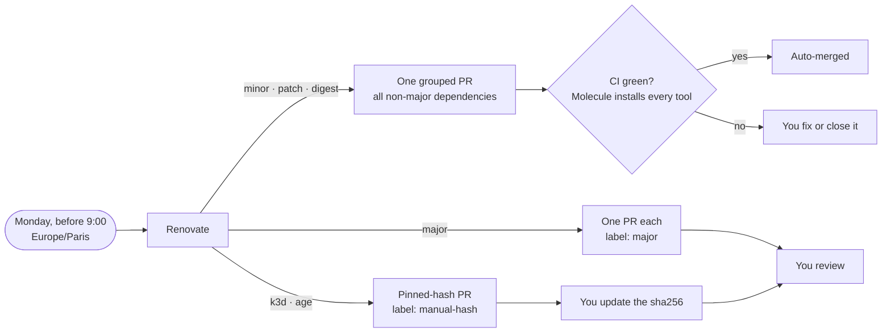

# Handle dependency updates

Renovate owns every version in this repository: OpenTofu and providers, GitHub Actions
(pinned by digest), pre-commit hooks, the Ansible tool list, container images,
the Flux chart tags and the docs tooling.



## What you do

| PR | Action |
|---|---|
| **all non-major dependencies** | Nothing when green. When red, open the failing job: Molecule says which download or checksum broke. |
| **major** | Read the release notes linked in the PR; run `just check` on the branch; merge. |
| **pinned-hash tools** (`manual-hash`) | k3d and age publish no usable checksum file. Copy the new `sha256` from the official release into `ansible/roles/workstation/defaults/main.yml`, run `just molecule`, push to the PR. |

## How versions are found

Every pin carries a `# renovate: datasource=… depName=…` comment or follows a format Renovate understands
(`name==x.y.z` for PyPI, `image:tag@sha256:…` for images). The patterns live in `renovate.json`
(`customManagers`). After changing them, check what Renovate would extract:

```bash
LOG_LEVEL=warn npx -y -p node@24 -p renovate@44.255.1 -- \
  renovate --platform=local --dry-run=extract --report-type=file --report-path=/tmp/renovate.json
```

Renovate 44 needs Node.js 24 or later.

## The Dependency Dashboard

Renovate keeps one issue, *Dependency Dashboard*, listing pending, rate-limited and ignored updates.
Tick a box there to force a PR.
