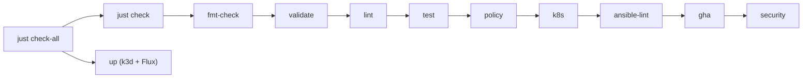

# Commands

Every task is a [`just`](https://just.systems) recipe. `just` alone opens a searchable menu (fzf) with a preview of each recipe; outside a terminal it lists them.
Run them inside the `iac` WSL distribution, at the repository root.

## Quality gates

| Recipe | What it runs | CI equivalent |
|---|---|---|
| `just check` | Every gate below except docs and Molecule, in this order | the pull-request workflows |
| `just check-all` | `check` + `up` | + `k8s-e2e.yml` |
| `just fmt-check` | `tofu fmt -check -recursive` on `terraform/` and `modules/` | `_tofu-plan.yml` |
| `just validate` | `tofu init -backend=false` + `tofu validate` in every stack | `_tofu-plan.yml` |
| `just lint` | tflint in every stack | — |
| `just test` | `tofu test` for every module with a `tests/` directory (mocked provider) | `tofu-test.yml` |
| `just policy` | `opa test policies/opentofu` | `policy.yml` |
| `just k8s` | `scripts/check-manifests.sh`: render overlays, kubeconform, Kyverno | `policy.yml` |
| `just ansible-lint` | ansible-lint, production profile | `ansible.yml` |
| `just molecule` | Molecule scenario of the workstation role (`IAC_MOLECULE_BINARIES=all` for every tool) | `ansible.yml` |
| `just gha` | actionlint + zizmor on `.github/workflows` | `zizmor.yml` |
| `just security` | Trivy (HIGH, CRITICAL) + Checkov | `security-scan.yml` |
| `just docs-lint [--offline]` | `scripts/check-docs.sh`: markdownlint, typos, lychee, Mermaid rendering | `docs-quality.yml` |
| `just docs` / `just docs-check` | Inject terraform-docs into module READMEs / fail if they are stale | `docs.yml` |
| `just commits [base]` | Commit policy on every commit since `base` (default `origin/main`) | `commit-policy.yml` |

## Self-service

| Recipe | Effect |
|---|---|
| `just request <issue>` | Turns a validated request issue (`request:ready`) into a signed commit and a pull request ([guide](../how-to/self-service.md)) |

## Environment

| Recipe | Effect |
|---|---|
| `just setup` | Installs git hooks (pre-commit and commit-msg) and Go modules |
| `just workstation` | Re-runs the workstation playbook: installs what changed, nothing else |
| `just up` | Creates the k3d cluster and registry if missing, installs Flux, pushes `kubernetes/`, waits for Ready |
| `just down` | Deletes the cluster and the registry |
| `just version` | Prints tool versions |
| `just clean` | Removes `.terraform/` directories and crash logs |

## OpenTofu stacks

| Recipe | Effect |
|---|---|
| `just plan <stack>` | `tofu init` + `tofu plan` (remote execution on HCP Terraform) |
| `just apply <stack>` | Same, then apply after a confirmation prompt |
| `just apply-auto <stack>` | Apply without prompt |
| `just new-stack <name>` | Scaffold a stack and its two workflows ([guide](../how-to/add-a-provider-stack.md)) |
| `just test-integration [filter]` | Terratest against the real GitHub API (creates and destroys repositories) |
| `just commit` | Conventional commit helper (czg if installed, else `git commit`) |
