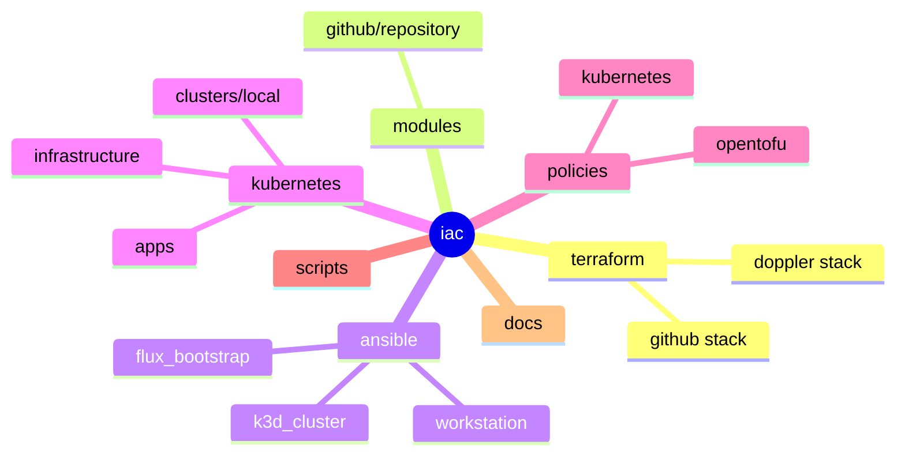

# Repository layout



```text
.
├── .github/
│   ├── workflows/            CI/CD (reference: docs/reference/workflows.md)
│   ├── ISSUE_TEMPLATE/       issue forms
│   ├── SECURITY.md           security policy
│   └── zizmor.yml            workflow audit configuration
├── ansible/                  workstation and cluster bootstrap (ansible/README.md)
│   ├── inventories/local.yml
│   ├── playbooks/            workstation.yml, cluster.yml
│   └── roles/                workstation (+ molecule/), k3d_cluster, flux_bootstrap
├── docs/                     tutorials, how-to, reference, explanation, ADRs, roadmap
├── kubernetes/               Flux layout (kubernetes/README.md)
│   ├── clusters/local/       entry point: OCI source + Kustomizations
│   ├── infrastructure/       namespaces, later controllers and observability
│   └── apps/                 workloads (podinfo demo)
├── modules/github/repository/ the module behind every repository (+ tests, terraform-docs README)
├── policies/                 OPA (plans) and Kyverno (manifests) (policies/README.md)
├── scripts/                  checks and bootstrap helpers (scripts/README.md)
├── terraform/                OpenTofu stacks (terraform/README.md)
│   ├── github/               14 repositories, labels, keys, files, Actions variables
│   └── doppler/              Doppler projects and CI tokens (to be replaced by SOPS + age)
├── tests/                    Terratest integration tests (Go)
├── justfile                  every command (docs/reference/commands.md)
├── renovate.json             dependency automation
└── .opentofu-version         OpenTofu version for every consumer
```
