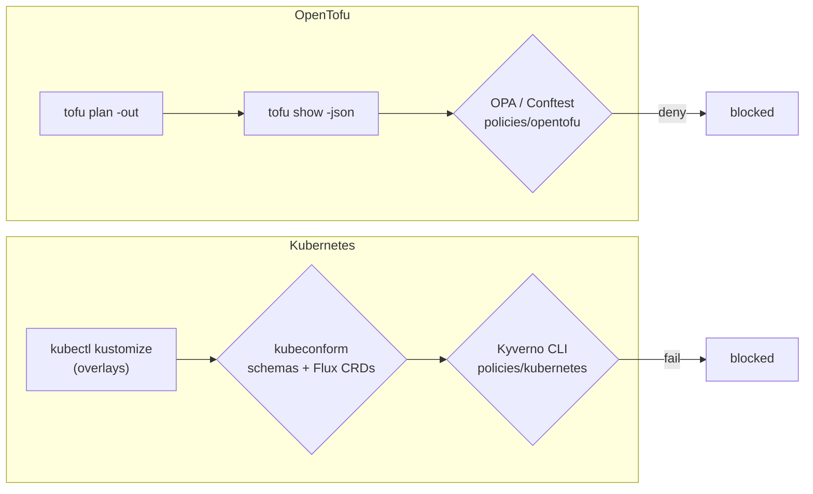

# Policies

Two independent safety nets: OPA rules on OpenTofu plans, Kyverno rules on Kubernetes manifests.
They still hold if a module or a chart loses its own protections.

## OpenTofu — `policies/opentofu/github.rego`

Rego v1, package `main` (the Conftest default), evaluated on the JSON plan.

| Rule | Level | Refuses / reports |
|---|---|---|
| Repository deletion | `deny` | any `github_repository` whose actions include `delete` — archive it instead (`archived = true`) |
| Public repository without vulnerability alerts | `deny` | a public, non-archived repository whose sibling `github_repository_vulnerability_alerts.this[0]` is absent, disabled or being deleted |
| Any other destroy | `warn` | every non-repository resource being destroyed, surfaced for review |

Tested by `policies/opentofu/github_test.rego` (8 cases): `just policy`, CI `policy.yml`.

> Status: unit-tested on every change. Enforcement on the real plan needs a saved plan (`tofu plan -out`),
> which the current HCP Terraform remote execution does not provide; it lands with phase 2 of the
> [roadmap](../ROADMAP.md).

## Kubernetes — `policies/kubernetes/baseline.yaml`

Kyverno 1.20 `ValidatingPolicy` objects (`policies.kyverno.io/v1`, CEL expressions), `validationActions: [Deny]`.

| Policy | Requires |
|---|---|
| `iac-helmrelease-remediation` | `install.remediation.retries` and `upgrade.remediation.retries` greater than 0 on every HelmRelease |
| `iac-oci-source-pinned` | `ref.tag`, `ref.semver` or `ref.digest` on every OCIRepository — no implicit `latest` |
| `iac-namespace-pod-security` | a `pod-security.kubernetes.io/enforce` label on every Namespace |

Run on the rendered overlays by `scripts/check-manifests.sh` (`just k8s`, CI `policy.yml`), after
kubeconform has validated the schemas, Flux CRDs included through the
[CRDs catalog](https://github.com/datreeio/CRDs-catalog).

## Adding a rule

1. Write the rule and at least one passing and one failing case (`*_test.rego` for OPA; a sample manifest for Kyverno).
2. `just policy` / `just k8s`.
3. Document it in the table above.
