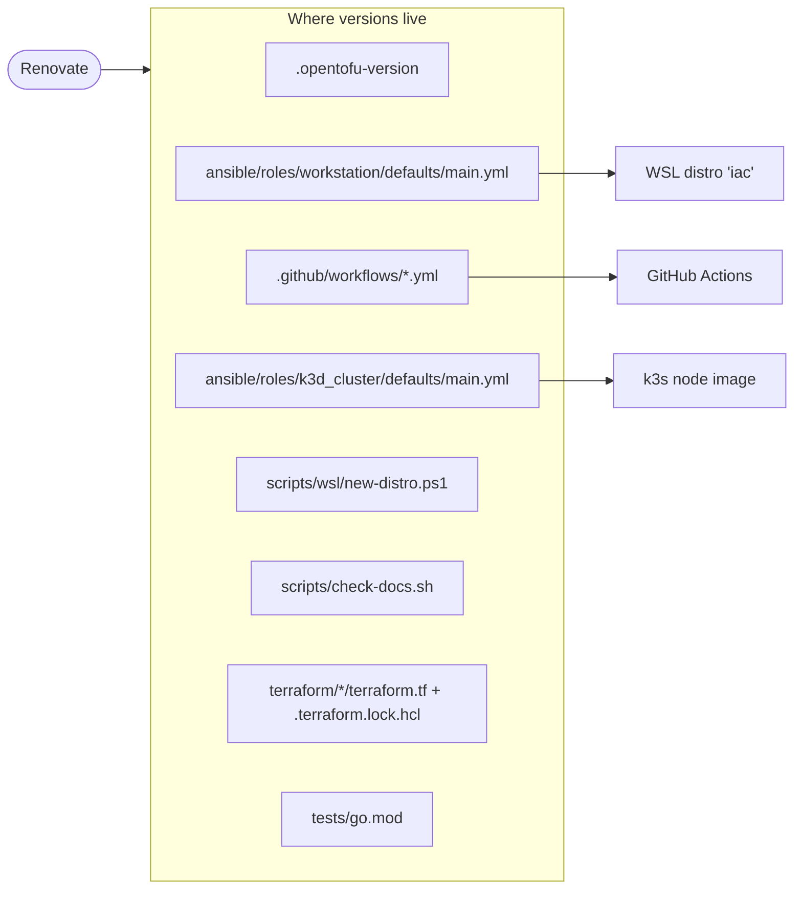

# Toolchain and pins

Every version below is pinned in exactly one place per consumer and carried by Renovate
([how](../how-to/update-dependencies.md)). Read the file for the current value; this page says where to look.

## Workstation tools

Installed by `ansible/roles/workstation` from the official release of each project, verified against the
vendor checksum file, or against a pinned `sha256` when the vendor publishes none.

| Tool | Purpose | Verification |
|---|---|---|
| tofu | OpenTofu CLI | vendor `SHA256SUMS` |
| k3d | k3s in Docker | pinned sha256 (vendor file uses a `_dist/` path) |
| kubectl | Kubernetes CLI | vendor `.sha256` |
| helm | Helm 4 | vendor `.sha256sum` |
| flux | Flux CLI | vendor checksums |
| sops, age | Secrets encryption | vendor checksums / pinned sha256 (age) |
| tflint, terraform-docs, trivy | Lint, module docs, scanner | vendor checksums |
| just | Task runner | vendor checksums |
| conftest, opa, kyverno, kubeconform | Policy as code | vendor checksums |
| actionlint, lychee | Workflow lint, link checker | vendor checksums |
| gh, fzf | GitHub CLI (`just request`), command menu | vendor checksums |
| Go | Terratest | vendor `.sha256` |
| zizmor, checkov, pre-commit, ansible-lint, molecule, typos | Python CLIs | exact `==` pins, isolated uv tools |
| ansible-core | Ansible (with the Docker SDK for Molecule) | exact pin, uv tool |

## Images

| Image | Where | Pin |
|---|---|---|
| `debian:trixie` | WSL distribution, Molecule platform | tag + digest |
| `rancher/k3s` | k3d node image | tag + digest |
| `davidanson/markdownlint-cli2`, `minlag/mermaid-cli` | docs checks | tag + digest |

## OpenTofu

| Item | Where |
|---|---|
| OpenTofu version | `.opentofu-version`; stacks and modules require `>=` the same minor |
| Providers | `terraform/*/terraform.tf` (`~>` constraints) and the lock files, hashed for `linux_amd64`, `linux_arm64`, `darwin_arm64` and `windows_amd64` |
| tflint ruleset | `.tflint.hcl` |
