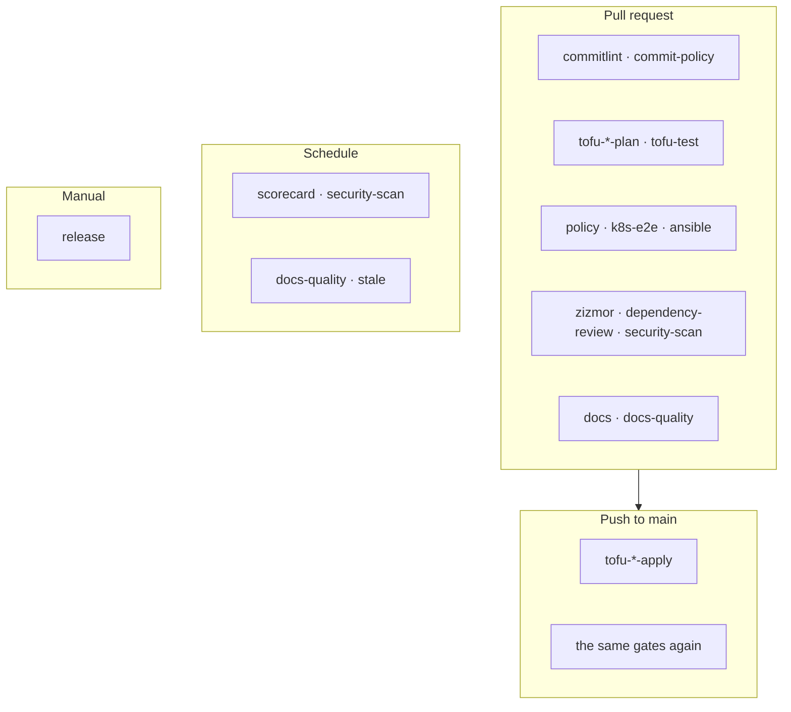

# Workflows

All workflows live in `.github/workflows/`. Every action is pinned by commit SHA, permissions are
read-only unless a job needs more, and the whole directory is audited by zizmor and actionlint.

| Workflow | Triggers | What it does |
|---|---|---|
| `commitlint.yml` | pull request | Conventional Commits on every commit of the PR |
| `commit-policy.yml` | pull request | `scripts/check-commit-msg.sh`: no co-author or generated-by trailer, the author's own sign-off |
| `tofu-github-plan.yml`, `tofu-doppler-plan.yml` | pull request (stack paths) | Call `_tofu-plan.yml`: fmt, init, validate, plan, plan posted as a PR comment |
| `tofu-github-apply.yml`, `tofu-doppler-apply.yml` | push to `main` (stack paths), manual | Call `_tofu-apply.yml`; one apply at a time, never cancelled |
| `_tofu-plan.yml`, `_tofu-apply.yml` | `workflow_call` | Reusable plan and apply; inputs reach the shell through `env` |
| `tofu-test.yml` | pull request, push, manual | `tofu test` of the modules (mocked provider) |
| `policy.yml` | pull request, push (policies, kubernetes) | OPA tests; render overlays, kubeconform, Kyverno |
| `k8s-e2e.yml` | pull request, push (kubernetes, ansible), manual | k3d cluster + Flux through `ansible/playbooks/cluster.yml`, waits for every Kustomization |
| `ansible.yml` | pull request, push (ansible), manual | ansible-lint; Molecule with every workstation binary |
| `zizmor.yml` | pull request, push | zizmor (online audits) and actionlint |
| `dependency-review.yml` | pull request | Fails on new dependencies with known vulnerabilities (moderate and above) |
| `security-scan.yml` | pull request, push, weekly, manual | Trivy and Checkov, results in the Security tab |
| `scorecard.yml` | push, weekly, manual | OpenSSF Scorecard |
| `docs.yml` | pull request, push (modules) | Fails if module READMEs differ from terraform-docs output |
| `docs-quality.yml` | pull request, push (Markdown), weekly, manual | `scripts/check-docs.sh`; pull requests check internal links only, external links are checked on `main`, weekly and on demand |
| `release.yml` | manual | Semver tag and GitHub release of the module |
| `requests.yml` | issue opened, edited, labelled (owner only) | Validates a request form with `scripts/request.py`, comments the exact change, labels `request:ready` or `request:invalid` |
| `commands.yml` | pull request labelled `run:*` (owner only) | Dispatches plans, end to end or every gate on the PR branch, then removes the label |
| `stale.yml` | weekly, manual | Marks and closes inactive issues and PRs |

## Conventions

- Top-level permissions read-only at most (`{}` or `contents: read`); each job asks for what it writes.
- `actions/checkout` with `persist-credentials: false`, unless a job pushes.
- Secrets passed explicitly to reusable workflows, never `secrets: inherit`.
- Tool versions carry a `# renovate:` comment so they move with the weekly update PR.
