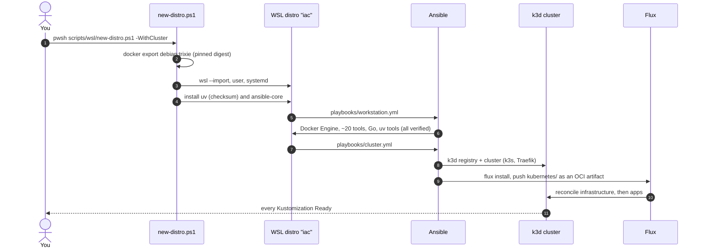

# Getting started

From a Windows PC to a green `just check` and a Kubernetes cluster reconciled by Flux, in four steps.
Count about 20 minutes, most of it downloads.

## What you need

- Windows 11 with WSL 2 up to date (`wsl --update`): cgroup v2 is required by k3s.
- Docker Desktop **or nothing**: the distribution installs Docker Engine itself.
- PowerShell 7 (`pwsh`) and Git for Windows, with this repository cloned.

## What happens



## 1. Build the distribution

From the repository root, in PowerShell:

```powershell
pwsh scripts/wsl/new-distro.ps1 -WithCluster
```

The script is idempotent; `-Recreate` rebuilds from scratch, `-SkipProvision` only imports the image.
Every tool comes from its official release and is checked against the vendor checksum
(see [Toolchain](../reference/toolchain.md)).

## 2. Open the distribution

```powershell
wsl -d iac
cd /mnt/d/DEV/iac   # adjust to where the repository lives
just setup          # git hooks (pre-commit, commit-msg) and Go modules
```

## 3. Run every gate

```bash
just check
```

This runs the same commands as CI, in this order: `tofu fmt`, `tofu validate`, tflint, `tofu test`,
OPA tests, kubeconform + Kyverno, ansible-lint, actionlint + zizmor, Trivy + Checkov.
Every one of them must pass before anything is pushed ([ADR 0002](../adr/0002-solo-flow.md)).

## 4. Look at the cluster

```bash
kubectl get nodes
flux get kustomizations      # infrastructure and apps: Ready
kubectl -n apps get pods     # podinfo, under the "restricted" Pod Security Standard
```

Change a manifest under `kubernetes/`, then `just up`: Flux reconciles your uncommitted change
([how it works](../explanation/gitops.md)). `just down` deletes the cluster when you are done.

## Next

- [Add a repository](../how-to/add-a-repository.md) to learn the OpenTofu flow.
- [Delivery pipeline](../explanation/pipeline.md) to see what happens after `git push`.
