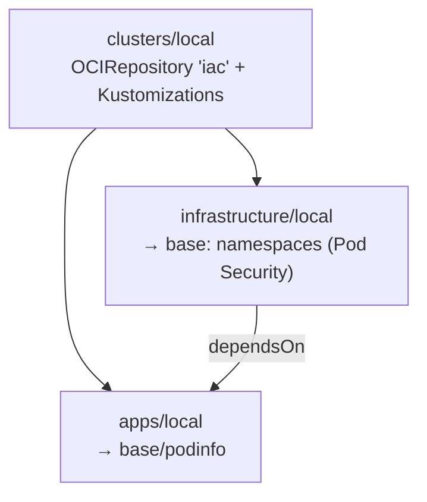

# kubernetes

What Flux reconciles, following the [Flux repository structure](https://fluxcd.io/flux/guides/repository-structure/).

| Path | Content |
|---|---|
| `clusters/local/` | entry point applied once by `ansible/roles/flux_bootstrap`: `source.yaml`, `infrastructure.yaml`, `apps.yaml` |
| `infrastructure/base/` | namespaces `apps` (`restricted`) and `observability` (`baseline`) |
| `apps/base/podinfo/` | demo: chart from `oci://ghcr.io/stefanprodan/charts/podinfo`, restricted security context |
| `*/local/` | overlays actually deployed on the k3d cluster |

Guides: [change manifests](../docs/how-to/change-kubernetes-manifests.md) · [how the loop works](../docs/explanation/gitops.md) · [policies](../docs/reference/policies.md).
