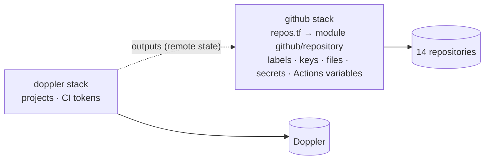

# terraform

OpenTofu root modules ("stacks"). Each stack has its own state and its own plan/apply workflows.

| Stack | Manages | Workflows |
|---|---|---|
| `github/` | every repository of the account through [`modules/github/repository`](../modules/github/repository/README.md), labels, deploy keys, injected files, Actions secrets and variables | `tofu-github-plan.yml`, `tofu-github-apply.yml` |
| `doppler/` | Doppler projects and CI service tokens (to be replaced by SOPS + age, roadmap D8) | `tofu-doppler-plan.yml`, `tofu-doppler-apply.yml` |

State and runs live in HCP Terraform (organisation `gregoiref`) until phase 2 of the
[roadmap](../docs/ROADMAP.md) moves them to OpenTofu-encrypted state in this repository.

Guides: [add a repository](../docs/how-to/add-a-repository.md) · [add a stack](../docs/how-to/add-a-provider-stack.md) · [release the module](../docs/how-to/release-the-module.md).
